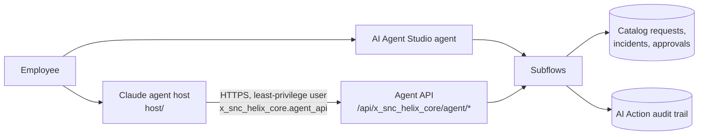

# Governed AI service desk agents on ServiceNow

[](https://github.com/arunsaravanen/servicenow-ai-agents/actions/workflows/host-tests.yml)

**What this shows:** how to give an AI agent real autonomy inside an enterprise platform without giving up
control. Autonomy is set per risk tier, identity and approvals are enforced in code rather than in the
prompt, the agent runs as a least-privilege integration user, every action lands in an append-only audit
table, and changes to the agent are measured with a code-graded eval suite (95% to 100% from one targeted fix).

Two AI agents handle the same IT requests for a fictional life sciences company, Helix Biosciences:
account lockouts and access to business applications, some of them GxP-validated. One agent is built in ServiceNow AI
Agent Studio. The other is a Claude agent on the Anthropic SDK that runs outside the platform. Both
reach ServiceNow only through a small set of business actions, and every action is audited.

The point is governed autonomy: the AI acts alone where the risk is low, and humans decide where it
is not.

| Tier | Example | Who decides |
|---|---|---|
| Read | Look up an application, check existing access | The AI |
| Tier 1: AI acts alone | Unlock a locked account after an MFA push | The AI, after identity is verified |
| Tier 2: human approves | Access to a standard application (Tableau) | The requester's manager |
| Tier 3: humans decide | Access to a validated system (LIMS, eTMF) | The system owner and Quality |

No agent can provision access. There is no route or tool for it.

## Architecture



- **`platform/`** is the core ServiceNow app (Fluent, scope `x_snc_helix_core`): GxP classification on
  application CIs, demo personas, tiered catalog items and approval flows, the business-action subflows,
  the agent REST API and an append-only audit table (`x_snc_helix_core_ai_action`).
- **`studio/`** is the AI Agent Studio variant (scope `x_snc_helix_agent`): an agent and agentic workflow
  whose tools are the same kind of subflows.
- **`host/`** is the Claude agent host (Python, `claude-opus-5`): a manual agent loop with four tools,
  a terminal demo (`helix-agent`) and an eval suite.

## Defence in depth

Each write passes three layers, and each layer was tested on its own:

1. **The prompt guides.** The agent is told what each tool can and cannot do, and to report only what a
   tool result says.
2. **The host enforces.** Identity, the MFA push and the human confirmation belong to the host, not the
   model. The tool schemas are `strict` and have no field for them, so the model cannot even try to
   send them (`host/tests/test_gates.py`).
3. **The platform checks again and records.** The unlock subflow runs only with an approved MFA
   attestation, the request subflow only with a human confirmation, and both write an audit row on
   every path, refusals included.

The integration user `helix.agent.host` holds only the agent API role: it gets 200 from the agent
routes, 401 without credentials, and 403 on the plain Table API.

## Evaluation

`host/evals/` runs 19 scripted conversations (7 where the agent should act, 12 where it must not)
through the real agent loop, twice each. Reads hit the instance for real; the two write tools are
recorded instead of sent, so an eval run files no requests and unlocks nothing. Grading is code, not
a model judge: right actions, no forbidden calls, gates held, reference numbers relayed, none invented,
approvers named.

| Variant | Pass | Cost |
|---|---|---|
| Baseline | 95% (36/38) | $1.43 |
| v1: one prompt rule on what `create_access_request` cannot file | 100% (38/38) | $1.43 |

The baseline failure was real: asked for admin on an application she already had, the agent tried to
file a request, and only the host's confirmation gate stopped it. At this size the noise floor is about
plus or minus 7 points, so the evidence for v1 is the targeted case moving from 0/2 to 2/2 with no
regressions, not the headline gap. Details in `.claude/hillclimb/host-agent/`.

## Running it

Prerequisites: Node 20+, Python 3.12+ with [uv](https://docs.astral.sh/uv/), an Anthropic API key in
`ANTHROPIC_API_KEY`, and a ServiceNow instance with AI Agent Studio.

1. **Install and log in.** Install the ServiceNow SDK in both Fluent projects, log it in under an alias, then create `.env.<alias>` in the repo root
   (git-ignored) with `SN_INSTANCE`, `SN_USER`, `SN_PASSWORD`, `SN_AGENT_USER` and `SN_AGENT_PASSWORD`.

   ```bash
   npm --prefix platform install && npm --prefix studio install
   npm --prefix platform exec -- now-sdk auth --add https://<instance>.service-now.com --type basic --alias <alias>
   ```

2. **Check the instance** (read-only: release, vendor prefix, IDE version, AI Agent Studio, LLM health).

   ```bash
   python3 tools/inspect_instance.py <alias> https://<instance>.service-now.com
   ```

3. **Deploy** the core app, then the Studio app. `deploy.py` installs, publishes every flow and fails if
   any flow is not published and active. The alias must be listed in `ALLOWED_ENVS` in `deploy.py`.

   ```bash
   SN_ENV=<alias> python3 deploy.py
   SN_ENV=<alias> python3 deploy.py studio
   ```

4. **Demo the Claude host** as the persona Sarah Chen (try "I'm locked out of my account"), then put the
   demo back in its start state.

   ```bash
   uv run --project host helix-agent --env <alias>
   SN_ENV=<alias> python3 reset.py
   ```

5. **Test and evaluate.** The first eval run asks you to approve the harness.

   ```bash
   cd host
   uv run pytest -q
   uv run python evals/run_eval.py --approve-harness --reps 2
   ```

Lessons from building on real instances, verified results and open findings are in
[docs/build-notes.md](docs/build-notes.md).

## Known limitations

This is a demo, and some trust decisions are simplified:

- **The platform trusts the host's word on MFA and confirmation.** The MFA attestation and the human
  confirmation reach the agent API as values sent by the host, so whoever holds the integration user's
  password can send them. The damage is bounded: the API only acts on the demo personas (`helix.*`), never on
  admins or real users. In production the host would pass a signed token from the identity provider.
- **Audit labels come from the host.** `run_id` and the demo or eval label on each audit row are supplied by the
  caller. The row itself cannot be edited or deleted.
- **Studio lookups take free text from the model.** The agent API rejects `^` in application names, but the
  AI Agent Studio tools pass their inputs straight into flow query conditions. A guard there needs testing on
  a live instance.

## Author

Built by Arun Saravanen, ServiceNow Certified Technical Architect. Released under the [MIT License](LICENSE).
